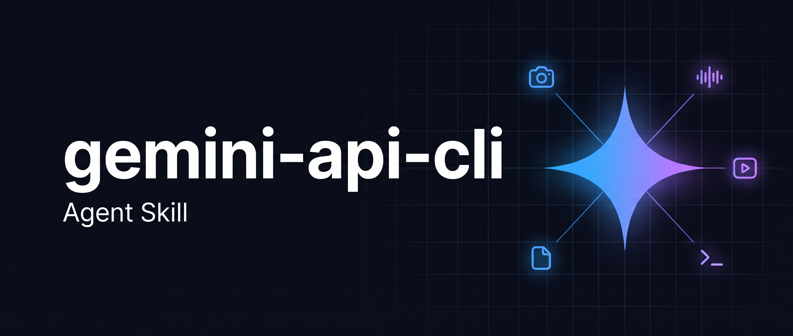

<div align="center">



# gemini-api-cli skill

Teach any coding agent to drive the Gemini API from the shell with the official `gemini-api` CLI.

[](LICENSE)
[](https://github.com/nikships/gemini-api-cli-skill/stargazers)

</div>

## What is this?

An [Agent Skill](https://agentskills.io) for [`google-gemini/gemini-api-cli`](https://github.com/google-gemini/gemini-api-cli) (`gemini-api`). Google's repo has no skill, so this one fills the gap. Hand it to an agent and it can generate text and structured JSON, create and edit images, produce speech, music and video, analyze PDFs, images, audio, video and YouTube links, transcribe to SRT, upload large files, and run background managed agents such as Deep Research.

The recipes were checked against `gemini-api` v0.4.4. The CLI is in beta, so the skill tells agents to re-read `--help` if a flag changes.

## Quick Start

Add the skill with the [`skills`](https://github.com/vercel-labs/skills) CLI:

```bash
npx skills add nikships/gemini-api-cli-skill
```

Pick one agent and skip prompts:

```bash
npx skills add nikships/gemini-api-cli-skill --skill gemini-api-cli -a claude-code -y
```

Install globally for every project with `-g`. Preview what the repo contains with `--list`.

Then install the CLI and set a key:

```bash
curl -fsSL https://raw.githubusercontent.com/google-gemini/gemini-api-cli/main/scripts/install.sh | bash
export GEMINI_API_KEY="YOUR_API_KEY"
gemini-api whoami
```

Ask your agent: "Use Gemini to make a hero image at `./assets/hero.jpg` and a voiceover for it."

## What the skill covers

| Task | Command |
|------|---------|
| Text, JSON schema output, multi-turn | `gemini-api generate` |
| Image generation and conversational edits | `gemini-api image` |
| Speech, music, video | `gemini-api tts`, `music`, `video` |
| Document, image, audio, video, YouTube Q&A | `gemini-api analyze` |
| Transcripts and captions | `gemini-api transcribe` |
| Files over ~14 MB | `gemini-api files upload` |
| Deep Research and background agents | `gemini-api agent run --background` |

## Project Structure

```
assets/
  banner.jpg
skills/
  gemini-api-cli/
    reference.md
    SKILL.md
LICENSE
README.md
```

`skills/<name>/SKILL.md` is a layout the `skills` CLI discovers automatically.

## Documentation

| Resource | Description |
|----------|-------------|
| [`SKILL.md`](skills/gemini-api-cli/SKILL.md) | Agent rules, command picker, verified recipes, troubleshooting |
| [`reference.md`](skills/gemini-api-cli/reference.md) | Every flag, body field, tool type, and response shape |
| [gemini-api-cli](https://github.com/google-gemini/gemini-api-cli) | The upstream CLI |
| [skills CLI](https://github.com/vercel-labs/skills) | How `npx skills add` installs and updates skills |

Update later with `npx skills update`.

## License

MIT. See [LICENSE](LICENSE). This project is unaffiliated with Google; `gemini-api-cli` is licensed by Google under Apache 2.0.
